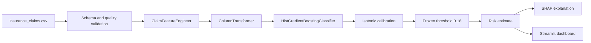

# Insurance Claim Fraud Risk Detection Using Explainable Machine Learning

An explainable, leakage-controlled machine-learning research prototype for prioritising insurance claims for human investigation. It produces a fraud-risk estimate and feature-level explanation; it does not determine that fraud occurred.

This repository contains the final-year M.Tech project of **Ms. S. Shaheen**, Annamacharya Institute of Technology and Sciences, Tirupati, Andhra Pradesh, India.

## Table of contents

- [Project overview](#project-overview)
- [Problem statement](#problem-statement)
- [Objectives](#objectives)
- [Technologies](#technologies)
- [Dataset](#dataset)
- [Methodology](#methodology)
- [Data validation and preprocessing](#data-validation-and-preprocessing)
- [Feature engineering](#feature-engineering)
- [Models and selection methodology](#models-and-selection-methodology)
- [Verified evaluation results](#verified-evaluation-results)
- [Explainable AI](#explainable-ai)
- [System architecture](#system-architecture)
- [Streamlit dashboard](#streamlit-dashboard)
- [Repository structure](#repository-structure)
- [Installation on Windows](#installation-on-windows)
- [Running the project](#running-the-project)
- [Testing](#testing)
- [Security and data handling](#security-and-data-handling)
- [Limitations](#limitations)
- [Future enhancements](#future-enhancements)
- [Responsible AI](#responsible-ai)
- [Author](#author)

## Project overview

Insurance claim fraud screening is a binary classification problem with an operational trade-off: missing a potentially fraudulent claim may be costly, while incorrectly flagging a genuine claim consumes investigation capacity. This project evaluates that trade-off using fraud-sensitive metrics, validation-only threshold selection, calibration experiments, and SHAP-based explanations.

The current production bundle is `models/claim_risk_pipeline_v2.joblib`. The Streamlit application loads this saved bundle at startup and does not train or retrain a model when the dashboard is opened.

## Problem statement

Given structured insurance claim information available at assessment time, estimate the likelihood that `fraud_reported` is `Y` and present the result in a form that supports human review. The prediction is a risk-ranking aid, not a fraud finding, denial decision, or legal conclusion.

## Objectives

- Validate the raw claim schema and surface data-quality issues.
- Preserve the original raw dataset and avoid target leakage.
- Build one reusable preprocessing path for training and inference.
- Engineer domain-relevant claim, policy-duration, ratio, and missing-document features.
- Compare classical and tree-based classifiers under stratified validation.
- Select an operating threshold using training-side validation data only.
- Calibrate and explain the selected model with SHAP.
- Provide single-claim and batch screening through Streamlit.
- Audit uncertainty, stability, feature robustness, and project limitations.

## Technologies

- Python 3.14.7 in the audited development environment
- pandas and NumPy for data handling
- scikit-learn for validation, preprocessing, models, calibration, and metrics
- imbalanced-learn for the fold-local SMOTE experiment
- XGBoost for the optional experimental comparison
- `google-genai` for optional investigator summaries grounded in verified model outputs
- SHAP for global and local model explanations
- Streamlit for the dashboard
- joblib for versioned model serialization
- pytest for automated tests

The exact dependency declarations are in [requirements.txt](requirements.txt). CatBoost and LightGBM were not installed in the audited environment and are not part of the verified results.

## Dataset

The preserved source file is [data/insurance_claims.csv](data/insurance_claims.csv).

| Property | Value |
|---|---:|
| Records | 1,000 |
| Original columns | 39 |
| Target | `fraud_reported` |
| Non-fraud (`N`) | 753 |
| Fraud (`Y`) | 247 |
| Held-out test records | 200 |
| Fraud records in held-out test set | 49 |

The CSV is included as a local project input. Its external provenance and licence were not verified during this audit; confirm redistribution rights before publishing the data or deploying the project.

## Methodology

The verified training protocol uses:

1. Raw CSV loading and schema validation.
2. Separation of `fraud_reported` from model inputs.
3. Stratified 80/20 train/test split with `random_state=42`.
4. Stratified five-fold cross-validation on the training partition.
5. Fit-aware feature engineering and `ColumnTransformer` preprocessing inside the estimator pipeline.
6. Training-side validation for calibration and threshold selection.
7. One final evaluation on the untouched held-out test partition.

The production model is a `HistGradientBoostingClassifier` with isotonic calibration and a frozen threshold of `0.18`.

## Data validation and preprocessing

The validation implementation is in [src/data_validation.py](src/data_validation.py). It checks required columns, target values, duplicate rows, date parsing, date ordering, numeric ranges, claim-component reconciliation, unexpected columns, and literal missing-value tokens.

The three source columns containing `?` tokens are:

- `collision_type` — 178 tokens
- `property_damage` — 360 tokens
- `police_report_available` — 343 tokens

The shared preprocessing implementation is in [src/preprocessing.py](src/preprocessing.py). It uses a scikit-learn `Pipeline` and `ColumnTransformer` with numerical imputation/scaling and categorical imputation plus unknown-safe one-hot encoding. The same fitted pipeline is used during training, dashboard inference, and batch scoring.

The audit identified one source record where `incident_date` precedes `policy_bind_date`. This is reported by validation and is not silently rewritten. The sentinel `umbrella_limit=-1000000` is handled as a missing/sentinel value by the feature-processing policy.

## Feature engineering

Fit-aware transformations are implemented in [src/feature_engineering.py](src/feature_engineering.py). The engineered features include:

- `policy_age_days`: incident date minus policy binding date.
- `customer_tenure_years`: `months_as_customer / 12`.
- `claim_amount_per_tenure_year`: total claim amount divided by customer tenure.
- `is_high_value_claim`: total claim amount at or above the training-fold 90th percentile.
- `vehicle_claim_ratio`, `injury_claim_ratio`, and `property_claim_ratio`: each component divided by total claim amount.
- `missing_doc_count`: count of missing document-related fields.
- `is_odd_hour_incident`: indicator for an incident hour outside the ordinary daytime range.
- `vehicle_age_at_incident`: incident year minus vehicle year.
- `claim_amount_to_annual_premium`: total claim amount divided by annual premium.
- `claim_component_gap`: total claim amount minus the sum of claim components.

The complete formulas, rationale, exclusions, and leakage discussion are in [docs/FEATURE_ENGINEERING.md](docs/FEATURE_ENGINEERING.md).

## Models and selection methodology

The primary training implementation is in [src/modeling.py](src/modeling.py). Candidate families include Logistic Regression, Decision Tree, Random Forest, Extra Trees, HistGradientBoosting, and a fold-local Logistic Regression plus SMOTE experiment. Checkpoint F additionally evaluated tuned HistGradientBoosting and XGBoost.

The production choice was not based on accuracy alone. Selection considered cross-validation PR-AUC, stability, recall, precision, F1, ROC-AUC, calibration, interpretability, and the fraud-screening threshold trade-off. The saved production artifact remains calibrated HGB even though an experimental XGBoost run had higher accuracy on this one held-out split.

## Verified evaluation results

The production values below match [reports/checkpoint_c_v2/final_test_metrics.json](reports/checkpoint_c_v2/final_test_metrics.json) and the recalculation in [reports/checkpoint_g/recalculated_production_metrics.json](reports/checkpoint_g/recalculated_production_metrics.json).

### Production held-out results

| Metric | Value |
|---|---:|
| Accuracy | 81.50% |
| Precision | 58.33% |
| Recall | 85.71% |
| F1-score | 69.42% |
| ROC-AUC | 0.835 |
| PR-AUC / Average Precision | 0.535 |
| Brier score | 0.123 |
| Specificity | 80.13% |
| Frozen threshold | 0.18 |

### Production confusion matrix

|  | Predicted non-fraud | Predicted fraud |
|---|---:|---:|
| Actual non-fraud | 121 | 30 |
| Actual fraud | 7 | 42 |

At this threshold, the model catches 42 of 49 fraud claims in the held-out partition but produces 30 false positives. That trade-off is appropriate for investigation prioritisation only if review capacity and the cost of missed fraud justify it.

### Cross-validation stability

The base HGB five-fold training-partition PR-AUC values were `0.658, 0.743, 0.716, 0.670, 0.570`, with mean ± standard deviation `0.671 ± 0.059`.

### Verified Checkpoint F comparison

These values are recorded in [reports/checkpoint_f/experiment_comparison.csv](reports/checkpoint_f/experiment_comparison.csv). Experimental held-out metrics use thresholds selected from training-side validation for each candidate; they are not replacements for the calibrated production result above.

| Model | CV PR-AUC ± SD | Test accuracy | Test precision | Test recall | Test F1 | Test ROC-AUC | Test PR-AUC |
|---|---:|---:|---:|---:|---:|---:|---:|
| Tuned HGB | 0.704 ± 0.049 | 82.50% | 60.29% | 83.67% | 70.09% | 0.824 | 0.536 |
| Default HGB | 0.671 ± 0.059 | 82.00% | 59.42% | 83.67% | 69.49% | 0.847 | 0.558 |
| Balanced Logistic Regression | 0.667 ± 0.063 | 83.50% | 64.81% | 71.43% | 67.96% | 0.830 | 0.532 |
| XGBoost | 0.647 ± 0.067 | 84.50% | 63.64% | 85.71% | 73.04% | 0.841 | 0.568 |
| Balanced Extra Trees | 0.631 ± 0.049 | 84.00% | 62.69% | 85.71% | 72.41% | 0.850 | 0.560 |
| Balanced Random Forest | 0.603 ± 0.056 | 82.00% | 59.15% | 85.71% | 70.00% | 0.850 | 0.551 |

The audit did not treat the XGBoost accuracy result as proof of generalisable improvement. Its cross-validation PR-AUC was below HGB's, and independent validation on a larger or temporal dataset is still required.

Additional charts are available under [reports/checkpoint_c_v2/](reports/checkpoint_c_v2/): confusion matrix, ROC, precision-recall, calibration, and SHAP summary images.

## Explainable AI

SHAP functionality is implemented in [src/explainability.py](src/explainability.py). It explains the actual transformed features consumed by the model, including one-hot encoded categorical features where applicable. The dashboard exposes global mean absolute SHAP importance, local positive contributions, local negative contributions, and a plain-language summary.

SHAP values describe model associations and are not causal explanations. The strong observed signals for `incident_severity_Major Damage`, `insured_hobbies_chess`, and `insured_hobbies_cross-fit` should be investigated for sampling artefacts, proxy effects, and fairness risks before any operational use.

## System architecture



The inference path loads the complete saved bundle through [src/predict.py](src/predict.py). The target column is excluded from prediction inputs.

## Streamlit dashboard

The entrypoint is [app/app.py](app/app.py). It provides:

- **Overview:** dataset counts, fraud rate, selected model, and key metrics.
- **Claim risk prediction:** validated single-claim form with probability and risk category.
- **Batch screening:** CSV upload without requiring target labels and downloadable scored output.
- **Explainability:** global and individual SHAP contributions.
- **Model performance:** confusion matrix, ROC, precision-recall, calibration, and saved metrics.
- **Data quality:** missing-token counts, duplicates, validation warnings, and missing-value summaries.

The UI labels outputs as risk assessments for investigation prioritisation. When
`GEMINI_API_KEY` is configured in Streamlit secrets, the optional Gemini summary
uses only the saved prediction and verified SHAP contributions. Without the key,
the deterministic rule-based summary remains available.

## Repository structure

```text
insurance-claim-risk/
├── app/app.py
├── data/insurance_claims.csv
├── docs/                 # data, model, explainability, dashboard, and audit documentation
├── models/               # versioned and legacy serialized model files
├── notebooks/            # original exploratory and baseline notebooks
├── reports/              # checkpoint C, F, and G outputs
├── src/                  # validation, features, preprocessing, modeling, SHAP, inference
├── tests/                # pytest suite
├── requirements.txt
├── .gitignore
└── README.md
```

Important files include [models/claim_risk_pipeline_v2.joblib](models/claim_risk_pipeline_v2.joblib), [src/modeling.py](src/modeling.py), [src/robustness_audit.py](src/robustness_audit.py), and [app/app.py](app/app.py). The dashboard explicitly loads `claim_risk_pipeline_v2.joblib`.

## Installation on Windows

```powershell
cd C:\Users\dhill\insurance-claim-risk
py -m venv .venv
.venv\Scripts\Activate.ps1
python -m pip install --upgrade pip
python -m pip install -r requirements.txt
```

If PowerShell blocks activation, use the environment interpreter directly:

```powershell
.venv\Scripts\python.exe -m pip install -r requirements.txt
```

No API key is required for the ML dashboard or rule-based explanations. An
optional `GEMINI_API_KEY` Streamlit secret enables Gemini investigator summaries.

For local Streamlit use, create `.streamlit/secrets.toml` (do not commit it):

```toml
GEMINI_API_KEY = "your-key-here"
```

For Streamlit Community Cloud, add the same key under the app's **Settings →
Secrets** panel. The key is read through `st.secrets` and is never displayed or
logged.

## Running the project

### Start the dashboard

```powershell
.venv\Scripts\python.exe -m streamlit run app/app.py
```

If port 8501 is occupied:

```powershell
.venv\Scripts\python.exe -m streamlit run app/app.py --server.port 8502
```

The dashboard uses the saved production artifact and does not retrain at startup.

### Run the read-only robustness audit

```powershell
.venv\Scripts\python.exe -m src.robustness_audit
```

Audit outputs are written to `reports/checkpoint_g/` without replacing the production artifact.

### Reproduce model development

```powershell
.venv\Scripts\python.exe -m src.modeling
```

The training command refuses to overwrite an existing artifact. Use a new versioned output path for any new experiment.

## Testing

```powershell
.venv\Scripts\python.exe -m pytest -q
```

The tests cover schema validation, missing-value handling, feature engineering, preprocessing, artifact loading, prediction validation, SHAP alignment, and dashboard startup. The last verified run completed with **13 passed**.

## Security and data handling

The audit found no `.env` files and no API keys, passwords, access tokens, or credential values in project source. The [`.gitignore`](.gitignore) excludes environment files, credentials, keys, virtual environments, caches, and local CSV/XLSX data by default.

The dataset contains claim-level records and should be treated as potentially sensitive. Do not publish additional private data, identifiers, credentials, or unverified dataset copies. Confirm the dataset licence and obtain the necessary permissions before redistribution.

## Limitations

- The dataset has only 1,000 records and 247 positive labels.
- The held-out evaluation contains 200 records and 49 fraud cases, so metrics are sensitive to a small number of claims.
- There is no external, temporal, prospective, or multi-insurer validation.
- The source data contains one invalid incident/policy date ordering and missing-value tokens.
- Isotonic calibration was selected using a relatively small training-side validation sample; calibrated probabilities should not be treated as proven real-world probabilities.
- Hobby-related features may be spurious or proxy variables and require dedicated fairness and stability analysis.
- SHAP does not establish causation.
- A model score is not proof of fraud and must not be used as the sole basis for claim denial, accusation, or adverse treatment.
- Dataset provenance and licence were not verified as part of this local repository audit.

See [docs/FINAL_PROJECT_LIMITATIONS.md](docs/FINAL_PROJECT_LIMITATIONS.md) and [docs/STATISTICAL_VALIDATION.md](docs/STATISTICAL_VALIDATION.md) for the full robustness discussion.

## Future enhancements

- Validate on a larger, independently sourced and temporally separated dataset.
- Monitor calibration, drift, subgroup performance, and false-negative rates.
- Investigate the stability and acceptability of hobby-related predictors.
- Establish pre-registered threshold and model-selection criteria for future studies.
- Establish data governance, access controls, retention rules, and audit trails.
- Add prospective human-review outcomes and feedback-loop monitoring.
- Reassess calibration with a larger representative calibration sample.

## Responsible AI

This is an academic research prototype. A flagged claim should receive additional human review, not automatic adverse treatment. Reviewers should consider the model output alongside claim evidence, policy context, and applicable law and organisational policy. Model explanations are aids for questioning and review; they should not be interpreted as causal proof or as a substitute for investigation.

## Author

**Ms. S. Shaheen**

Final-Year M.Tech Project

Annamacharya Institute of Technology and Sciences

Tirupati, Andhra Pradesh, India

## Git commands for review and publication

These commands are provided for the author to review and run manually. No push was performed by this task:

```powershell
git status
git add README.md
git diff --cached
git commit -m "Update README with complete project documentation"
git push origin main
```
